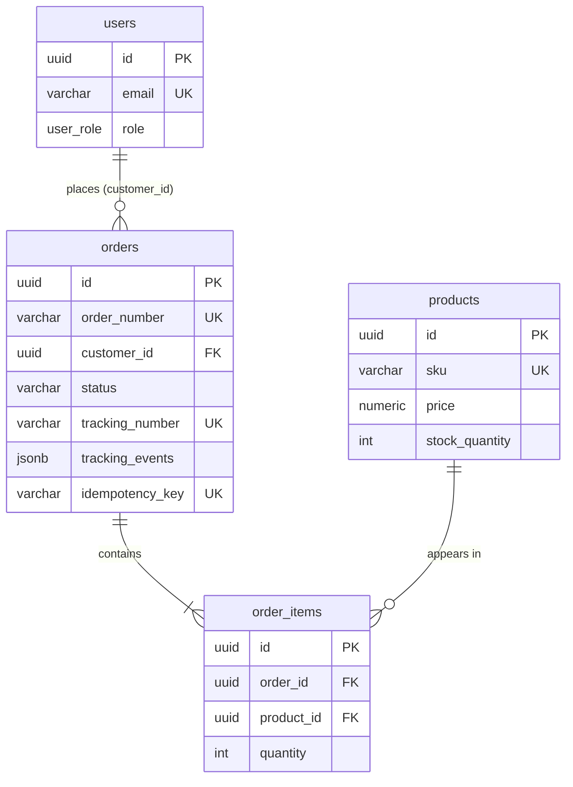

# قاعدة البيانات — ERD ومخطط الجداول

أربعة جداول فقط التزامًا بقيد الجامعة. عنوان الشحن وبيانات الناقل وسجل التتبع محفوظة داخل `orders`.

## الكائنات الإضافية

- `CREATE TYPE user_role AS ENUM ('ADMIN','CUSTOMER')`
- `CREATE SEQUENCE order_number_seq START 1` — رقم الطلب: `ORD-{YYYY}-{seq:06d}`

## الجداول

### users (9 حقول)
`id` UUID PK · `full_name` VARCHAR(150) · `email` VARCHAR(255) UNIQUE · `phone` VARCHAR(30) NULL · `password_hash` VARCHAR(255) · `role` user_role DEFAULT 'CUSTOMER' · `is_active` BOOLEAN DEFAULT true · `created_at`, `updated_at` TIMESTAMPTZ.

### products (10 حقول)
`id` UUID PK · `name` VARCHAR(200) INDEX · `sku` VARCHAR(64) UNIQUE · `description` TEXT NULL · `category` VARCHAR(100) INDEX NULL · `price` NUMERIC(12,2) CHECK ≥ 0 · `stock_quantity` INTEGER CHECK ≥ 0 · `image_url` VARCHAR(500) NULL · `is_active` BOOLEAN DEFAULT true · `created_at`, `updated_at` TIMESTAMPTZ.

### orders (23 حقلًا)
`id` UUID PK · `order_number` VARCHAR(30) UNIQUE · `customer_id` UUID FK→users RESTRICT INDEX · `status` VARCHAR(20) CHECK (الحالات السبع) · `payment_method` CHECK (COD, CARD) · `payment_status` CHECK (UNPAID, PAID) · `subtotal`, `shipping_fee`, `total_amount` NUMERIC(12,2) مع قيود عدم السلبية و `total = subtotal + shipping_fee` · `shipping_name`, `shipping_phone`, `shipping_city`, `shipping_address` (نسخة من عنوان العميل) · `carrier` NULL · `tracking_number` UNIQUE NULL · `tracking_events` JSONB DEFAULT '[]' · `shipped_at`, `delivered_at`, `cancelled_at` NULL · `idempotency_key` VARCHAR(100) UNIQUE · `created_at`, `updated_at`.

قيد إضافي: `tracking_number` إلزامي من حالة `SHIPPED` فصاعدًا.

### order_items (8 حقول)
`id` UUID PK · `order_id` UUID FK→orders RESTRICT INDEX · `product_id` UUID FK→products RESTRICT INDEX · `product_name`, `sku`, `unit_price` (Snapshot) · `quantity` INTEGER CHECK > 0 · `line_total` NUMERIC CHECK = quantity × unit_price.

## الفهارس

`ix_products_name` · `ix_products_category` · `ix_orders_customer_created(customer_id, created_at DESC)` · `ix_orders_status` · `ix_orders_created_at` · `ix_order_items_order_id` · `ix_order_items_product_id`.

## قواعد مهمة

- المفاتيح من `uuid.uuid4` في Python، و`updated_at` عبر `onupdate=func.now()`.
- `tracking_events` يُعدَّل بإعادة تعيين القائمة بالكامل حتى يرصد SQLAlchemy التغيير.
- لا `ON DELETE CASCADE`؛ التعطيل المنطقي عبر `is_active = false`.
- عند تعديل `stock_quantity` أو إلغاء طلب: قفل الصفوف بترتيب `id` لتفادي Deadlock.
- مسار الترقية إن سُمح بجدول خامس: استخراج `tracking_events` إلى `order_events`.
